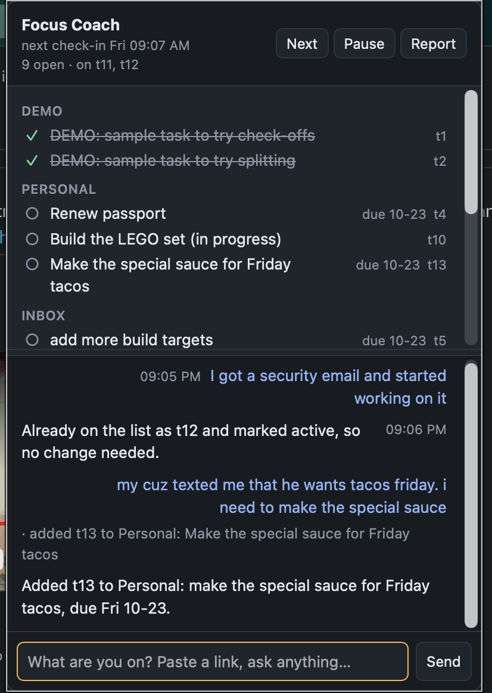

# Focus Coach

A local app that keeps one person on track during the workday. It keeps a task list, checks in on a timer, and uses an LLM to read your replies and keep the list current. It can also look things up for you, draft messages, and write an end-of-day report.

<p align="center"></p>

## Install

You need Rust 1.88 or later, and the GitHub CLI signed in (`gh auth login`) for PR lookups.

```sh
cargo install --locked --path crates/focus   # the `focus` CLI and terminal UI, in ~/.cargo/bin
```

The menubar app is optional:

```sh
cargo install --locked tauri-cli --version "^2"
cd crates/menubar && cargo tauri build       # target/release/bundle/macos/Focus Coach.app
```

Drag `Focus Coach.app` to Applications and turn on **Start at login** in its menu. CI also builds it for every push to `main` (see [development](docs/development.md#ci)). A downloaded build isn't signed, so clear the quarantine flag after unzipping: `xattr -dr com.apple.quarantine "Focus Coach.app"`.

## Pick a model

- **The Claude API** (the default): `export ANTHROPIC_API_KEY=sk-ant-...`, or `ant auth login`.
- **Claude Code**, on your Claude Code login with no API key: set `provider = "claude-code"` under `[llm]`.
- **A local model** through Ollama or LM Studio.

Apps launched from Finder don't see your shell's environment variables, so with the menubar app use `ant auth login`, Claude Code or a local model. See [models](docs/models.md).

## Your first day

```sh
focus start "look at my PRs and make a task list"   # builds the list and starts check-ins
focus                                              # the terminal UI; or click the menubar icon
```

When a check-in arrives, answer it in a few words ("yup, still on the deploy", "started on the security fix"), and the coach keeps the list current. Settings live in `~/.focus/focus.toml`, written on first run with every option explained; edits apply without a restart.

## Docs

- [Using it](docs/using.md): the CLI, the terminal UI, the menubar app and notifications, approvals, and the files in `~/.focus`.
- [Configuration](docs/configuration.md): `focus.toml`, with [the full commented example](docs/focus.example.toml).
- [Guides](docs/guides.md): replying to check-ins, working on several things, the progress check, Slack and Notion, adding tasks.
- [Models](docs/models.md): the Claude API, Claude Code and local models.
- [Development](docs/development.md): crate layout, tests and CI.
